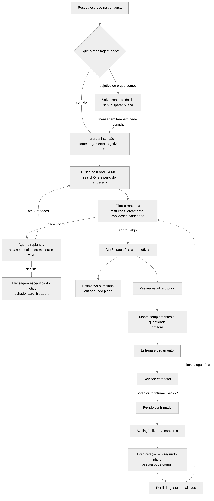

# 02 · Desenho de Solução

Equipe "iFood Benefícios" · Hackathon SEMCOMP × iFood 2026

**Item exigido:** Como o agente resolve o problema — fluxo geral da solução.

[Índice dos entregáveis](README.md)

## Fluxo geral

Fonte editável: [`diagramas/fluxo-solucao.mmd`](diagramas/fluxo-solucao.mmd)

## Preferências e filtragem

[Ver o diagrama horizontal de preferências](diagramas/README.md#preferências-e-filtragem).
Ele mostra como o perfil e o pedido atual orientam os filtros, o ranking e a
verificação nutricional. [Fonte editável em Mermaid](diagramas/preferencias-filtragem.mmd).

## Etapas

1. **Endereço.** A conversa usa os endereços da conta do iFood (`listAddresses`). Se houver mais de um, a pessoa escolhe no chat. Ela também pode cadastrar um novo (`createAddress`) ou trocar depois.
2. **Contexto.** Frases como "meu objetivo é ganhar massa" ou "hoje só comi frutas" ficam salvas e orientam as próximas buscas. O que a pessoa já comeu nunca vira o termo da busca.
3. **Intenção.** Um modelo de linguagem lê a mensagem e devolve um JSON validado: objetivos (muita fome, algo leve, pressa, pós-treino...), termos de comida e inferências. Regras locais garantem o que foi dito explicitamente, como o orçamento e o "sem pressa". Se o modelo falhar, as regras sozinhas fazem o trabalho.
4. **Busca.** Até quatro consultas paralelas ao `searchOffers`, só com restaurantes abertos e com o preço máximo nos `refinements`. Sem itens, o sistema procura restaurantes pelo termo e lê seus cardápios (`browseOffers`). Se ainda assim não houver nada, confere se os itens existem com o restaurante fechado.
5. **Ranking.** Filtros obrigatórios vêm primeiro: disponibilidade, orçamento, restrições e aversões. Depois a ordem combina:
   - aderência ao pedido e às intenções;
   - avaliações (a nota pessoal, a afinidade por cozinha e a comunidade);
   - aspectos citados nos comentários;
   - variedade em relação às últimas sugestões.
6. **Replanejamento.** Se o ranking zerar, um modelo recebe o diagnóstico (quantos fechados, quantos acima do orçamento, quantos filtrados). Ele decide tentar outras consultas, relaxar o orçamento padrão do perfil (nunca o orçamento pedido) ou explicar. No modo live, ele pode pedir chamadas de leitura ao MCP, que o código valida antes de executar.
7. **Nutrição.** Para cada sugestão, a pipeline nutricional roda em segundo plano. A conversa não espera: os números aparecem no card quando ficam prontos.
8. **Compra.** A pessoa monta o prato, escolhe entrega e pagamento e revisa o total. Só o botão de confirmação ou a frase explícita "confirmar pedido" fecham o pedido.
9. **Avaliação.** Depois do pedido, nota opcional e comentário livre. Um modelo interpreta nota e aspectos em segundo plano. A pessoa vê a interpretação, pode corrigir, e a correção prevalece.

## O que é real e o que é simulado

| Parte | Modo live | Modo mock (demo) |
|---|---|---|
| Endereços | iFood (`listAddresses`, `createAddress`) | Endereços fictícios locais |
| Busca, cardápio, item | iFood (`searchOffers`, `browseOffers`, `getMerchant`, `getItem`) | Catálogo fictício: 24 restaurantes, 121 pratos |
| Avaliações da comunidade | Indisponíveis no MCP | 360 avaliações fictícias |
| Entrega, pagamento, pedido | Bloqueados (risco de cobrança real, ver [Feedback sobre os MCPs](06-feedback-mcp.md)) | Simulados, sem cobrança |
| Nutrição, intenção, replanejamento | Reais (modelos de IA) | Reais (modelos de IA) |
