# 04 · Interface Visual

Equipe "iFood Benefícios" · Hackathon SEMCOMP × iFood 2026

**Item exigido:** Telas, protótipo ou interface que representa a experiência final.

[Índice dos entregáveis](README.md)

Telas reais do Macro, capturadas do aplicativo rodando no modo de demonstração (catálogo, endereço e pedidos fictícios, sem cobrança). As telas de celular estão em 390 px de largura. O racional de cada decisão está no [entregável 03 · Racional da Experiência](03-racional-da-experiencia.md).

<video controls preload="metadata" width="100%" style="max-width: 900px">
  <source src="apresentacao/video.mp4" type="video/mp4">
  Seu navegador não conseguiu carregar o vídeo. <a href="apresentacao/video.mp4">Abra o arquivo MP4 diretamente</a>.
</video>

## Jornada completa

### 1. Início

A conversa é a tela principal. Exemplos prontos ensinam o que o Macro entende. O endereço fica no cabeçalho, e as preferências ficam a um toque.

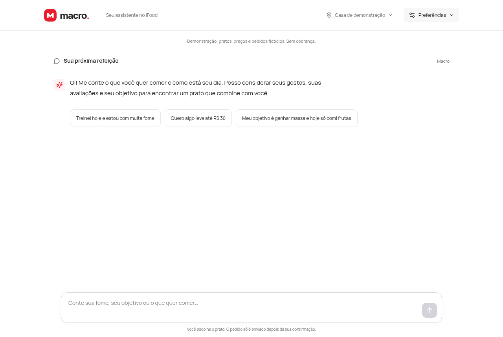

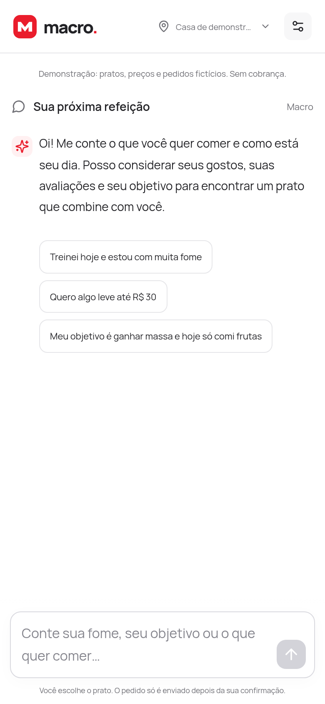

### 2. Contexto do dia

"Meu objetivo é ganhar massa e hoje só comi frutas" salva o objetivo e o que já foi consumido. Isso não dispara uma busca: o Macro só pergunta o que a pessoa quer comer.

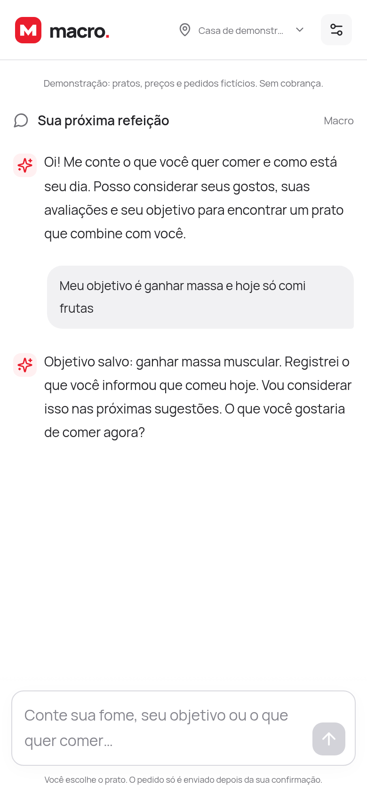

### 3. Sugestões

"Treinei hoje e estou com muita fome, quero algo até R$ 45". O Macro resume o que entendeu e mostra até três pratos de restaurantes diferentes. Cada card traz:
- a porção;
- a estimativa de calorias e macros (faixa);
- o sinal das avaliações;
- até três motivos de "Por que este prato?".

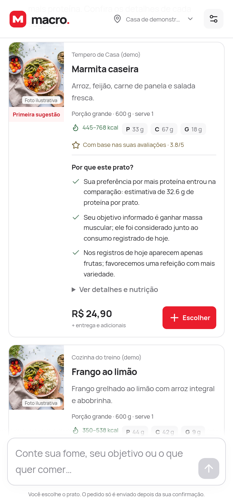 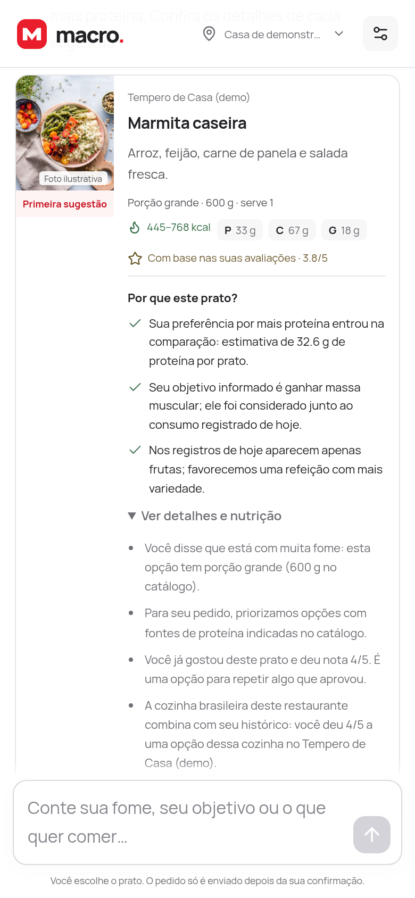

### 4. Montar o prato

Complementos obrigatórios e opcionais, quantidade e subtotal. Também dá para escrever ("arroz integral", "2 unidades", "continuar").

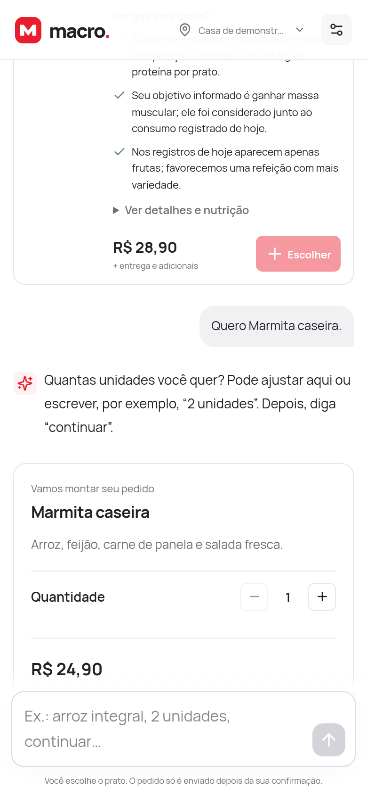

### 5. Entrega e pagamento

Escolha por botão, número ou nome.

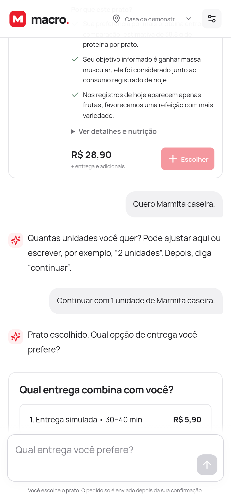

### 6. Revisão

Itens com estimativa nutricional, endereço, entrega, pagamento e total. O endereço, a entrega e o pagamento podem ser alterados ali mesmo. Só o botão com o total ou "confirmar pedido" fecham o pedido.

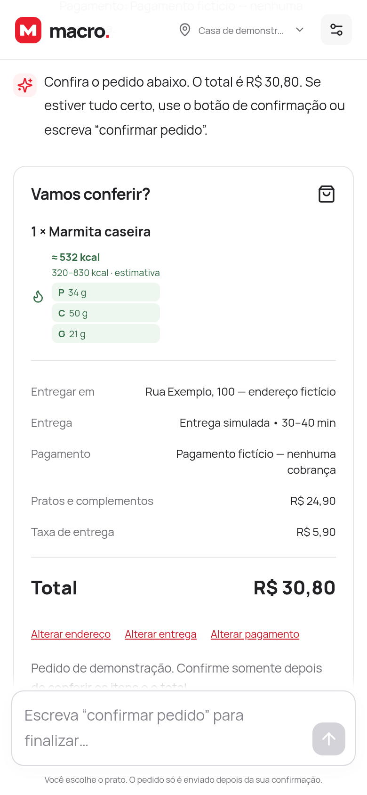

### 7. Avaliação

Nota opcional e comentário livre. O Macro interpreta o comentário em segundo plano: a nota, os aspectos (sabor, entrega, porção) e um resumo. A pessoa pode corrigir a interpretação.

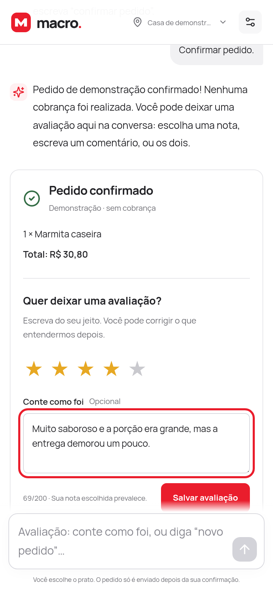 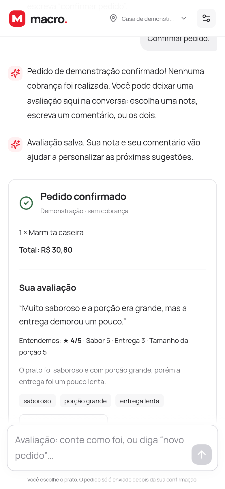

## Outras telas

### Endereço de entrega

Pelo cabeçalho ou dizendo "trocar endereço", a pessoa escolhe entre os endereços salvos. Com "adicionar endereço", cadastra um novo em duas etapas: localizar e depois confirmar com bairro e complemento.

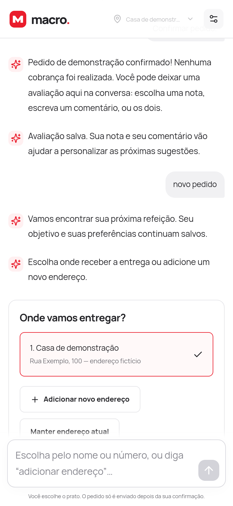 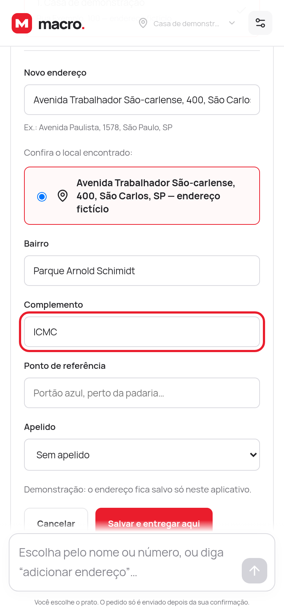

### Preferências

Objetivo, gostos, restrições, aversões, orçamento padrão e metas nutricionais opcionais, numa configuração compacta dentro da conversa.

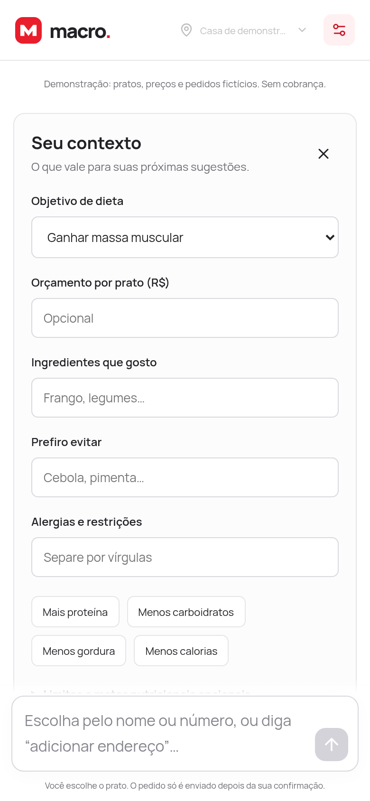
