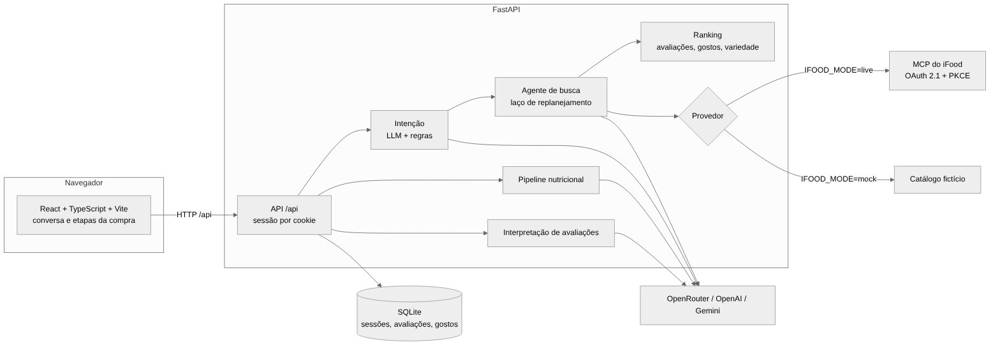

# 05 · Documento Técnico Resumido

Equipe "iFood Benefícios" · Hackathon SEMCOMP × iFood 2026 · Macro

## Arquitetura

Fonte editável: [`diagramas/arquitetura.mmd`](diagramas/arquitetura.mmd)

| Camada | Tecnologia | Onde |
|---|---|---|
| Interface | React 19, TypeScript, Vite | `frontend/src/` |
| API | FastAPI, Pydantic | `app/api/endpoints/macro.py`, `app/schemas/` |
| Integração iFood | SDK oficial `mcp` (Python), OAuth com PKCE | `app/services/ifood_live.py`, `app/services/ifood_mcp.py` |
| Agente de busca | Laço com skills em Markdown | `app/services/busca_agente.py`, `app/skills/` |
| Nutrição | Pipeline em cascata | `app/services/nutrition/` |
| Persistência | SQLite | `app/storage/database.py` |
| Modelos | OpenRouter (gratuitos, com reservas), OpenAI, Gemini | `app/services/llm_texto.py` e clientes |

## Uso do MCP do iFood

**Ferramentas usadas:**

| Ferramenta | Para quê |
|---|---|
| `listAddresses` | Endereços da conta para a entrega |
| `createAddress` | Geocodificar e cadastrar endereço (duas etapas, com confirmação) |
| `searchOffers` | Busca de itens e de restaurantes, com `refinements` (`onlyOpen`, `maxItemPrice`) |
| `browseOffers` | Cardápio de um restaurante, com paginação por `nextPageToken` |
| `getMerchant` | Confere se o restaurante está aberto antes de detalhar |
| `getItem` | Descrição, preço e grupos de complementos |
| `listItemTaxonomy` | Categorias, para o agente planejar buscas |

**Como o agente usa o MCP com segurança.** O modelo nunca chama o MCP diretamente. Ele só pede (nome e argumentos em JSON), e o código decide:

1. **Lista de permissões.** Só ferramentas de leitura passam (`READ_TOOLS`). A única escrita liberada é `createAddress`, que não cobra nada. Carrinho e `submitOrder` estão bloqueados no modo live.
2. **Schema real.** Antes de cada chamada, os argumentos são validados contra o `inputSchema` devolvido por `tools/list`, com JSON Schema. Se o contrato mudar, a chamada falha com um erro claro em vez de enviar dados errados.
3. **IDs só vistos.** `merchantId` e IDs de categoria só são aceitos se já apareceram em respostas anteriores. O modelo não consegue inventar IDs.
4. **Localização fixa.** A latitude e a longitude vêm do endereço escolhido. O modelo não as informa nem altera.
5. **Resumo, não JSON bruto.** O modelo recebe um resumo curto (nomes, abertos, preços, IDs). Textos vindos do iFood são tratados como dado, nunca como instrução.
6. **Limites.** No máximo 3 chamadas por passo, páginas pequenas, prazo total da busca e número máximo de replanejamentos.

**Autenticação.** OAuth 2.1 com PKCE e client pré-registrado. Os tokens ficam em arquivo no servidor e são renovados pelo refresh token antes de vencer (`refresh_if_expired`), porque o SDK, sozinho, tentaria abrir um navegador. Corrigimos também uma divergência de issuer do servidor de login (detalhes no 06).

## Decisões técnicas principais

| Decisão | Por quê |
|---|---|
| **Modo mock e modo live atrás da mesma interface de provedor** | A demo e os testes rodam sem conta nem cobrança. O código da conversa, do ranking e do agente é o mesmo nos dois modos. |
| **Confirmação de pedido por regra fixa, não por LLM** | Um erro de interpretação não pode gerar uma compra. Cada revisão gera uma versão nova, e a confirmação só vale para a versão exibida: se entrega ou pagamento mudarem, é preciso revisar de novo. |
| **LLM decide, código garante** | O modelo interpreta e replaneja, mas filtros de restrição, orçamento pedido e confirmação ficam no código e valem mesmo que o modelo peça o contrário. |
| **Todo LLM tem fallback** | Cada chamada tem prazo e cadeia de reservas (vários modelos gratuitos no OpenRouter, depois OpenAI). Se tudo falhar, a intenção cai nas regras locais e a busca vazia cai numa mensagem fixa. A conversa nunca quebra por causa de um modelo. |
| **Nutrição em segundo plano, com cache** | A pipeline pode levar segundos. As sugestões aparecem já, e o card atualiza depois. O resultado fica em cache por item e complementos. Em produção, o cálculo iria para o cadastro do prato (ver abaixo). |
| **Ranking de avaliações determinístico** | Notas e aspectos entram numa fórmula explícita, com prior para amostras pequenas. É explicável, testável e não envia comentários a um modelo externo. |
| **Privacidade nos logs** | Por padrão, os logs da busca só têm contagens. Texto do usuário e respostas dos modelos só aparecem com `BUSCA_LOG_CONTEUDO=true`. Segredos ficam em `.env`. |

## Pipeline nutricional

Para cada prato, fontes em cascata e em paralelo (`app/services/nutrition/pipeline.py`):

1. **Base local de produtos** para itens industrializados conhecidos.
2. **Tabela TACO**, com busca aproximada pelo nome e um juiz que pode se abster.
3. **Busca na web** (OpenAI ou Gemini com Google Search), só quando as bases não acham.
4. **Estimativas independentes:** um modelo só com o texto, outro com texto e foto (Gemini), e a soma dos ingredientes casados com a TACO.
5. **Consenso** entre as estimativas, ajustado pela porção extraída da descrição.
6. **Validação** por regras (fator de Atwater, limites plausíveis) e pela dispersão entre as fontes. O resultado é uma faixa com nível de confiança.

## Nutrição em produção: calcular no cadastro, não no pedido

**Como funciona no protótipo.** O cálculo é feito sob demanda: a pipeline roda na primeira vez que um prato aparece para alguém. O resultado vai para um cache em memória e para uma base local. A chave é o restaurante, o item, os complementos escolhidos e a versão da pipeline. Da segunda vez em diante, o prato não é recalculado. Funciona porque o protótipo lida com poucos pratos e precisa calcular itens que o iFood não descreve nutricionalmente.

**Por que isso não escala.** Cada cálculo novo envolve várias consultas a modelos de IA e, às vezes, busca na web. Fazer isso no momento em que o cliente navega tem três problemas:
- **custo:** no catálogo do iFood, o primeiro acesso a cada item e a cada combinação de complementos dispararia a pipeline inteira;
- **latência:** o cliente espera segundos para ver um número que poderia já estar pronto;
- **consistência:** dois servidores podem calcular o mesmo prato ao mesmo tempo e chegar a faixas diferentes.

**Como seria em produção.** A informação nutricional passa a ser um atributo do produto, calculado no servidor quando o restaurante cadastra ou altera o item:

1. O restaurante cadastra ou edita um prato (nome, descrição, foto, complementos).
2. Um evento coloca o item numa fila de processamento.
3. Um worker roda a mesma pipeline (TACO, web, estimativas, consenso, validação) para o item e para cada complemento.
4. O resultado é gravado junto ao produto no catálogo, com a versão da pipeline e o nível de confiança.
5. A busca e o `getItem` já devolvem a nutrição pronta. O cliente nunca dispara o cálculo.

Complementos seriam calculados separadamente e somados na hora da montagem, uma conta simples. Assim não é preciso calcular cada combinação possível. A pipeline só roda de novo quando o item muda ou quando uma versão nova da pipeline justifica reprocessar o catálogo. Se o restaurante declarar a tabela nutricional, ela substitui a estimativa e a pipeline só valida os números.

Esse desenho depende do iFood: é a mesma sugestão do entregável 06 de expor nutrição no `getItem`.

## Qualidade

- **426 testes automatizados no backend** (`pytest`): API, agente de busca, MCP (validação, permissões, privacidade), pipeline nutricional, avaliações, intenção e conversa.
- **Testes dos comandos do chat** no frontend (`npm test`): confirmação explícita, escolha por número e nome, quantidade, endereço.
- A suíte roda sem serviços externos: `IFOOD_MODE=mock OPENAI_API_KEY='' .venv/bin/python -m pytest tests -q`.

## Limitações conhecidas

- O checkout real não foi executado: está bloqueado no modo live até existir um ambiente de teste sem cobrança.
- Avaliações da comunidade e metadados de porção existem só no catálogo fictício. No modo live, o ranking usa apenas as avaliações feitas no próprio Macro.
- A estimativa nutricional é uma estimativa. Não substitui informação declarada pelo restaurante nem orientação profissional.
- O perfil fica ligado ao cookie do navegador. Não há conta própria do Macro.
