# Diagramas do Macro

[Índice dos entregáveis](../README.md)

Diagramas horizontais e coloridos em Mermaid. O GitHub renderiza os fluxos abaixo;
os arquivos `.mmd` guardam as fontes editáveis.

## Pipeline nutricional

[Documento Técnico Resumido](../05-documento-tecnico-resumido.md) ·
[Fonte Mermaid](pipeline-nutrientes.mmd)

```mermaid
flowchart LR
    A["🍽️ Prato e complementos"] --> B{"Resultado<br/>no cache?"}

    B -->|Sim| R["📊 Calorias e macros<br/>faixa, fonte e confiança"]
    B -->|Não| C["🔎 Consultar fontes"]

    C --> D["📚 Bases nutricionais<br/>produtos e TACO"]
    D -->|Sem correspondência| E["🌐 Busca na web"]

    C --> F["🤖 Estimativas por IA<br/>texto e foto"]
    F --> G["🥗 Cálculo por ingredientes<br/>com apoio da TACO"]

    D --> H["⚖️ Combinar resultados"]
    E --> H
    F --> H
    G --> H

    H --> I["✅ Ajustar porção<br/>e validar nutrientes"]
    I --> J{"Dados<br/>suficientes?"}
    J -->|Sim| K["💾 Salvar no cache"]
    K --> R
    J -->|Não| L["⚠️ Nutrição indisponível"]

    classDef entrada fill:#DBEAFE,stroke:#2563EB,color:#172554
    classDef decisao fill:#FEF3C7,stroke:#D97706,color:#78350F
    classDef fontes fill:#CCFBF1,stroke:#0D9488,color:#134E4A
    classDef ia fill:#EDE9FE,stroke:#7C3AED,color:#3B0764
    classDef validacao fill:#FFEDD5,stroke:#EA580C,color:#7C2D12
    classDef resultado fill:#DCFCE7,stroke:#16A34A,color:#14532D
    classDef falha fill:#FEE2E2,stroke:#DC2626,color:#7F1D1D

    class A entrada
    class B,J decisao
    class C,D,E fontes
    class F,G ia
    class H,I validacao
    class K,R resultado
    class L falha
```

O fluxo combina fontes conhecidas com estimativas de IA, ajusta a porção e valida
os nutrientes. As etapas dependem dos dados, das configurações e dos provedores
disponíveis. Os valores apresentados são estimativas.

## Preferências e filtragem

[Desenho de Solução](../02-desenho-de-solucao.md) ·
[Fonte Mermaid](preferencias-filtragem.mmd)

```mermaid
flowchart LR
    A["👤 Preferências salvas<br/>gostos, aversões e restrições"] --> C["🧩 Combinar perfil<br/>com o pedido atual"]
    B["💬 Pedido atual<br/>comida, orçamento e objetivo"] --> C

    C --> D["🔎 Buscar candidatos<br/>no catálogo"]
    D --> E["🛑 Aplicar filtros<br/>disponibilidade, orçamento,<br/>restrições e aversões"]

    E --> F{"Sobrou algum<br/>resultado?"}
    F -->|Não| G["🔄 Replanejar a busca<br/>ou explicar os filtros"]
    G -->|"Novas consultas"| D

    F -->|Sim| H["⚖️ Ordenar por afinidade<br/>gostos, objetivo, avaliações<br/>e variedade"]
    H --> I{"Há critérios<br/>nutricionais?"}

    I -->|Sim| J["🥗 Verificar nutrientes<br/>comparar estimativas<br/>com os limites pedidos"]
    I -->|Não| K["🍽️ Até 3 sugestões<br/>com motivos da escolha"]
    J --> K

    classDef entrada fill:#DBEAFE,stroke:#2563EB,color:#172554
    classDef contexto fill:#EDE9FE,stroke:#7C3AED,color:#3B0764
    classDef busca fill:#CCFBF1,stroke:#0D9488,color:#134E4A
    classDef filtro fill:#FEE2E2,stroke:#DC2626,color:#7F1D1D
    classDef decisao fill:#FEF3C7,stroke:#D97706,color:#78350F
    classDef ranking fill:#FFEDD5,stroke:#EA580C,color:#7C2D12
    classDef resultado fill:#DCFCE7,stroke:#16A34A,color:#14532D

    class A,B entrada
    class C contexto
    class D,G busca
    class E filtro
    class F,I decisao
    class H ranking
    class J,K resultado
```

Restrições e aversões eliminam candidatos pelos dados disponíveis no catálogo.
Gostos e objetivos ajudam a ordenar os restantes. O replanejamento preserva as
restrições e o orçamento explícito do pedido. Critérios nutricionais podem acionar
a avaliação em lotes no modo live; limites numéricos e ausência de dados seguem as
regras documentadas no projeto. Restrições alimentares exigem confirmação com o
restaurante.

## Outros diagramas

- [Arquitetura](arquitetura.png) e [fonte Mermaid](arquitetura.mmd).
- [Fluxo geral da solução](fluxo-solucao.png) e [fonte Mermaid](fluxo-solucao.mmd).
