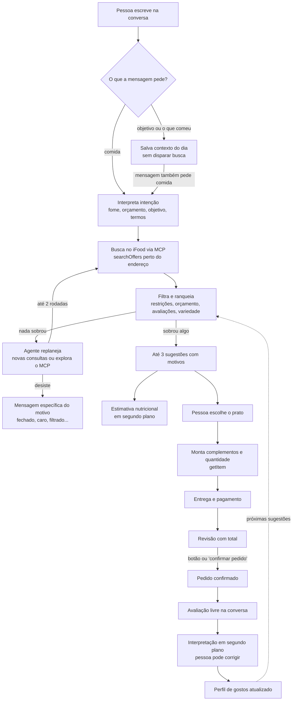
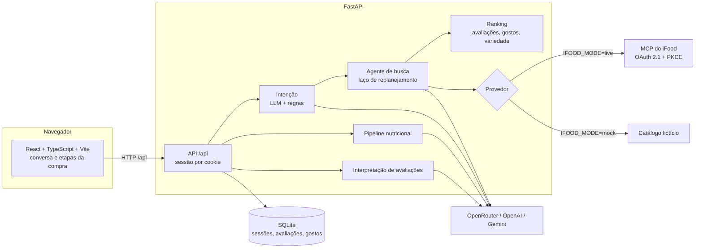

# Macro · Seu assistente de refeições no iFood

Equipe "iFood Benefícios" · Hackathon SEMCOMP × iFood 2026 · Vendendo com Agentes

Este documento reúne quatro dos seis entregáveis. Os outros dois estão em arquivos próprios:

| # | Entregável | Onde |
|---|---|---|
| 01 | Proposta de Negócio | [Seção 01](#01--proposta-de-negócio) |
| 02 | Desenho de Solução | [Seção 02](#02--desenho-de-solução) |
| 03 | Racional da Experiência | [Seção 03](#03--racional-da-experiência) |
| 04 | Interface Visual | [`04-interface-visual.md`](04-interface-visual.md) |
| 05 | Documento Técnico Resumido | [Seção 05](#05--documento-técnico-resumido) |
| 06 | Feedback sobre os MCPs | [`06-feedback-mcp.md`](06-feedback-mcp.md) |

Código: https://github.com/danieljmanzano/hackaton-ifood

---

## 01 · Proposta de Negócio

### O problema

Quem tem um objetivo com a alimentação (ganhar massa, emagrecer, comer melhor depois do treino) também pede delivery. Na hora de pedir, essa pessoa enfrenta três dificuldades:

1. **O cardápio não diz o que importa para ela.** O iFood mostra nome, foto, descrição e preço. Calorias e proteína quase nunca aparecem. A pessoa estima de cabeça ou desiste do delivery.
2. **Decidir cansa.** Ela precisa cruzar o que já comeu no dia, o objetivo, a fome do momento, o orçamento e o que está aberto. Rolar o app fazendo essa conta mental leva tempo e termina, muitas vezes, no pedido de sempre.
3. **As avaliações não respondem à pergunta dela.** Uma nota 4,6 não diz se a porção é grande, se o frango é seco ou se a comida chega fria. Isso está espalhado em comentários que ninguém lê antes de pedir.

> ⚠️ Equipe: incluir aqui a persona do demo (ex.: "Lucas, 24 anos, treina 5x por semana") e, se houver, algum dado ou relato que sustente o problema.

### A proposta

O **Macro** é um agente de conversa que funciona como complemento do iFood. A pessoa conta, do jeito dela, como está:

> "Treinei hoje, estou com muita fome e só comi frutas. Quero algo até R$ 35."

O Macro entende o objetivo, a fome, o orçamento e o que já foi consumido. Ele busca pratos reais abertos perto do endereço, pelo MCP do iFood. Depois sugere até três opções e explica cada escolha:
- a **estimativa de calorias e macros**, com faixa e nível de confiança;
- o que **as avaliações** dizem sobre porção, sabor e entrega;
- **por que** aquele prato combina com o pedido.

A pessoa escolhe, monta o prato, revisa o total e confirma, tudo na conversa. Depois da entrega, avalia com um comentário livre, e o Macro aprende com isso para as próximas sugestões.

### Proposta de valor

| Para quem pede | Para o iFood e os restaurantes |
|---|---|
| Decide mais rápido, sem conta mental | Mais conversão de quem hoje desiste por não saber o que pedir |
| Vê calorias e macros estimados, sem precisar procurar | Um público com objetivo de saúde, que pede com frequência |
| Recebe sugestões que respeitam restrições e aversões | Avaliações mais ricas (aspectos estruturados, não só nota) |
| Entende o porquê de cada sugestão | Pratos bons, mas pouco descobertos, ganham visibilidade |

### Diferenciais

- **Nutrição como estimativa honesta.** Os números vêm de uma pipeline com tabela TACO, busca na web e modelos de IA. Sempre aparecem como faixa e com nível de confiança, nunca como verdade.
- **Avaliações como sinal, não só nota.** Comentários viram aspectos (porção, oleosidade, entrega, custo-benefício) que influenciam o ranking e as justificativas.
- **A conversa é a interface.** Contexto, escolha, ajustes, pagamento e avaliação acontecem num só lugar.
- **Segurança por desenho.** O agente nunca confirma um pedido sozinho. "Sim" ou "ok" não finalizam a compra.

### Viabilidade

- Funciona sobre o MCP do iFood que já existe: busca, cardápio, detalhes do item e endereços.
- A estimativa nutricional usa fontes públicas (TACO) e modelos gratuitos ou baratos, com cache por item.
- Os pontos que dependem do iFood para produção estão no entregável 06: checkout sem cobrança para testes, dados nutricionais declarados e leitura de avaliações.

---

## 02 · Desenho de Solução

### Fluxo geral

### Etapas

1. **Endereço.** A conversa usa os endereços da conta do iFood (`listAddresses`). Se houver mais de um, a pessoa escolhe no chat. Ela também pode cadastrar um novo (`createAddress`) ou trocar depois.
2. **Contexto.** Frases como "meu objetivo é ganhar massa" ou "hoje só comi frutas" ficam salvas e orientam as próximas buscas. O que a pessoa já comeu nunca vira o termo da busca.
3. **Intenção.** Um modelo de linguagem lê a mensagem e devolve um JSON validado: objetivos (muita fome, algo leve, pressa, pós-treino...), termos de comida e inferências. Regras locais garantem o que foi dito explicitamente, como o orçamento e o "sem pressa". Se o modelo falhar, as regras sozinhas fazem o trabalho.
4. **Busca.** Até quatro consultas paralelas ao `searchOffers`, só com restaurantes abertos e com o preço máximo nos `refinements`. Sem itens, o sistema procura restaurantes pelo termo e lê seus cardápios (`browseOffers`). Se ainda assim não houver nada, confere se os itens existem com o restaurante fechado.
5. **Ranking.** Filtros obrigatórios vêm primeiro: disponibilidade, orçamento, restrições e aversões. Depois a ordem combina:
   - aderência ao pedido e às intenções;
   - avaliações (a nota pessoal, a afinidade por cozinha e a comunidade);
   - aspectos citados nos comentários;
   - variedade em relação às últimas sugestões.
6. **Replanejamento.** Se o ranking zerar, um modelo recebe o diagnóstico (quantos fechados, quantos acima do orçamento, quantos filtrados). Ele decide tentar outras consultas, relaxar o orçamento padrão do perfil (nunca o orçamento pedido) ou explicar. No modo live, ele pode pedir chamadas de leitura ao MCP, que o código valida antes de executar.
7. **Nutrição.** Para cada sugestão, a pipeline nutricional roda em segundo plano. A conversa não espera: os números aparecem no card quando ficam prontos.
8. **Compra.** A pessoa monta o prato, escolhe entrega e pagamento e revisa o total. Só o botão de confirmação ou a frase explícita "confirmar pedido" fecham o pedido.
9. **Avaliação.** Depois do pedido, nota opcional e comentário livre. Um modelo interpreta nota e aspectos em segundo plano. A pessoa vê a interpretação, pode corrigir, e a correção prevalece.

### O que é real e o que é simulado

| Parte | Modo live | Modo mock (demo) |
|---|---|---|
| Endereços | iFood (`listAddresses`, `createAddress`) | Endereços fictícios locais |
| Busca, cardápio, item | iFood (`searchOffers`, `browseOffers`, `getMerchant`, `getItem`) | Catálogo fictício: 24 restaurantes, 121 pratos |
| Avaliações da comunidade | Indisponíveis no MCP | 360 avaliações fictícias |
| Entrega, pagamento, pedido | Bloqueados (risco de cobrança real, ver 06) | Simulados, sem cobrança |
| Nutrição, intenção, replanejamento | Reais (modelos de IA) | Reais (modelos de IA) |

---

## 03 · Racional da Experiência

### Princípios

1. **A conversa é o produto.** A primeira versão tinha várias telas (visão geral, "Meu dia", restaurantes, pedidos, painel de metas). Removemos todas para que a decisão aconteça num só lugar: tudo é feito na conversa, com cartões de ação quando um botão é mais rápido que digitar.
2. **Complementar ao iFood, não substituto.** O Macro usa o endereço, os restaurantes e os pratos do iFood. Ele não recria cadastro, carteira ou histórico. Nosso valor é decidir melhor, não reconstruir o app.
3. **Toda escolha aceita botão ou texto.** Prato, complemento, entrega e pagamento podem ser escolhidos pelo botão, pelo número ("2") ou pelo nome ("rápida"). Se o texto for ambíguo, o Macro pergunta em vez de adivinhar.
4. **Dizer o contexto não compra nada.** "Meu objetivo é ganhar massa" salva o objetivo e responde. Não dispara uma busca que a pessoa não pediu. Se a mesma frase pedir comida, a busca acontece em seguida.

### Confiança

- **Confirmação só explícita.** "Sim", "ok" e "pode ser" não confirmam pedido. Só o botão com o total ou "confirmar pedido" depois da revisão. Também recusamos frases como "não confirmar pedido" ou "confirmar pedido se for barato". Essa regra não passa por modelo de IA: é uma regra fixa no código.
- **Estimativa é estimativa.** Calorias e macros aparecem como faixa, com origem e confiança. Quando não há dado, o card diz "indisponível" em vez de inventar.
- **Todo prato explica o porquê.** Cada sugestão traz até três motivos, como "Você tem pressa: a previsão máxima informada é de 30 minutos" ou "Vale considerar sua experiência anterior: você deu 5/5 para…".
- **Sem resultado, o motivo é específico.** Quando nada sobra, a mensagem diz se é porque está tudo fechado, se nada cabe no orçamento (e qual é o preço mais baixo) ou se os filtros cortaram tudo. Sempre sugere o que mudar.
- **Avaliação corrigível.** O Macro mostra como entendeu o comentário (nota e aspectos), e a pessoa corrige com um toque. A palavra dela vale mais que a do modelo.

### Fluidez

- **Nada trava a conversa.** A nutrição e a interpretação da avaliação rodam em segundo plano e aparecem quando prontas.
- **Até três sugestões, de restaurantes diferentes.** Poucas para decidir rápido, variadas para haver escolha real. A sessão lembra as últimas 18 sugestões para não repetir.
- **"Outra opção", "mais barato", "sem queijo"** funcionam porque o agente lê as últimas mensagens e um resumo da busca anterior.
- **Exemplos para começar.** A conversa vazia oferece frases prontas ("Treinei hoje e estou com muita fome"), que ensinam o que o Macro entende.
- **"Novo pedido" recomeça sem perder nada.** Objetivo, preferências e aprendizado das avaliações continuam.

### Acessibilidade

- A conversa é uma região `aria-live`: leitores de tela anunciam as respostas.
- Navegação completa por teclado, com foco visível e link "Ir para a conversa".
- Layout de uma coluna que funciona a partir de 320 px, sem rolagem horizontal.

---

## 05 · Documento Técnico Resumido

### Arquitetura

| Camada | Tecnologia | Onde |
|---|---|---|
| Interface | React 19, TypeScript, Vite | `frontend/src/` |
| API | FastAPI, Pydantic | `app/api/endpoints/macro.py`, `app/schemas/` |
| Integração iFood | SDK oficial `mcp` (Python), OAuth com PKCE | `app/services/ifood_live.py`, `app/services/ifood_mcp.py` |
| Agente de busca | Laço com skills em Markdown | `app/services/busca_agente.py`, `app/skills/` |
| Nutrição | Pipeline em cascata | `app/services/nutrition/` |
| Persistência | SQLite | `app/storage/database.py` |
| Modelos | OpenRouter (gratuitos, com reservas), OpenAI, Gemini | `app/services/llm_texto.py` e clientes |

### Uso do MCP do iFood

**Ferramentas usadas:**

| Ferramenta | Para quê |
|---|---|
| `listAddresses` | Endereços da conta para a entrega |
| `createAddress` | Geocodificar e cadastrar endereço (duas etapas, com confirmação) |
| `searchOffers` | Busca de itens e de restaurantes, com `refinements` (`onlyOpen`, `maxItemPrice`) |
| `browseOffers` | Cardápio de um restaurante, com paginação por `nextPageToken` |
| `getMerchant` | Confere se o restaurante está aberto antes de detalhar |
| `getItem` | Descrição, preço e grupos de complementos |
| `listItemTaxonomy` | Categorias, para o agente planejar buscas |

**Como o agente usa o MCP com segurança.** O modelo nunca chama o MCP diretamente. Ele só pede (nome e argumentos em JSON), e o código decide:

1. **Lista de permissões.** Só ferramentas de leitura passam (`READ_TOOLS`). A única escrita liberada é `createAddress`, que não cobra nada. Carrinho e `submitOrder` estão bloqueados no modo live.
2. **Schema real.** Antes de cada chamada, os argumentos são validados contra o `inputSchema` devolvido por `tools/list`, com JSON Schema. Se o contrato mudar, a chamada falha com um erro claro em vez de enviar dados errados.
3. **IDs só vistos.** `merchantId` e IDs de categoria só são aceitos se já apareceram em respostas anteriores. O modelo não consegue inventar IDs.
4. **Localização fixa.** A latitude e a longitude vêm do endereço escolhido. O modelo não as informa nem altera.
5. **Resumo, não JSON bruto.** O modelo recebe um resumo curto (nomes, abertos, preços, IDs). Textos vindos do iFood são tratados como dado, nunca como instrução.
6. **Limites.** No máximo 3 chamadas por passo, páginas pequenas, prazo total da busca e número máximo de replanejamentos.

**Autenticação.** OAuth 2.1 com PKCE e client pré-registrado. Os tokens ficam em arquivo no servidor e são renovados pelo refresh token antes de vencer (`refresh_if_expired`), porque o SDK, sozinho, tentaria abrir um navegador. Corrigimos também uma divergência de issuer do servidor de login (detalhes no 06).

### Decisões técnicas principais

| Decisão | Por quê |
|---|---|
| **Modo mock e modo live atrás da mesma interface de provedor** | A demo e os testes rodam sem conta nem cobrança. O código da conversa, do ranking e do agente é o mesmo nos dois modos. |
| **Confirmação de pedido por regra fixa, não por LLM** | Um erro de interpretação não pode gerar uma compra. Cada revisão gera uma versão nova, e a confirmação só vale para a versão exibida: se entrega ou pagamento mudarem, é preciso revisar de novo. |
| **LLM decide, código garante** | O modelo interpreta e replaneja, mas filtros de restrição, orçamento pedido e confirmação ficam no código e valem mesmo que o modelo peça o contrário. |
| **Todo LLM tem fallback** | Cada chamada tem prazo e cadeia de reservas (vários modelos gratuitos no OpenRouter, depois OpenAI). Se tudo falhar, a intenção cai nas regras locais e a busca vazia cai numa mensagem fixa. A conversa nunca quebra por causa de um modelo. |
| **Nutrição em segundo plano, com cache** | A pipeline pode levar segundos. As sugestões aparecem já, e o card atualiza depois. O resultado fica em cache por item. |
| **Ranking de avaliações determinístico** | Notas e aspectos entram numa fórmula explícita, com prior para amostras pequenas. É explicável, testável e não envia comentários a um modelo externo. |
| **Privacidade nos logs** | Por padrão, os logs da busca só têm contagens. Texto do usuário e respostas dos modelos só aparecem com `BUSCA_LOG_CONTEUDO=true`. Segredos ficam em `.env`. |

### Pipeline nutricional

Para cada prato, fontes em cascata e em paralelo (`app/services/nutrition/pipeline.py`):

1. **Base local de produtos** para itens industrializados conhecidos.
2. **Tabela TACO**, com busca aproximada pelo nome e um juiz que pode se abster.
3. **Busca na web** (OpenAI ou Gemini com Google Search), só quando as bases não acham.
4. **Estimativas independentes:** um modelo só com o texto, outro com texto e foto (Gemini), e a soma dos ingredientes casados com a TACO.
5. **Consenso** entre as estimativas, ajustado pela porção extraída da descrição.
6. **Validação** por regras (fator de Atwater, limites plausíveis) e pela dispersão entre as fontes. O resultado é uma faixa com nível de confiança.

### Qualidade

- **426 testes automatizados no backend** (`pytest`): API, agente de busca, MCP (validação, permissões, privacidade), pipeline nutricional, avaliações, intenção e conversa.
- **Testes dos comandos do chat** no frontend (`npm test`): confirmação explícita, escolha por número e nome, quantidade, endereço.
- A suíte roda sem serviços externos: `IFOOD_MODE=mock OPENAI_API_KEY='' .venv/bin/python -m pytest tests -q`.

### Limitações conhecidas

- O checkout real não foi executado: está bloqueado no modo live até existir um ambiente de teste sem cobrança.
- Avaliações da comunidade e metadados de porção existem só no catálogo fictício. No modo live, o ranking usa apenas as avaliações feitas no próprio Macro.
- A estimativa nutricional é uma estimativa. Não substitui informação declarada pelo restaurante nem orientação profissional.
- O perfil fica ligado ao cookie do navegador. Não há conta própria do Macro.
